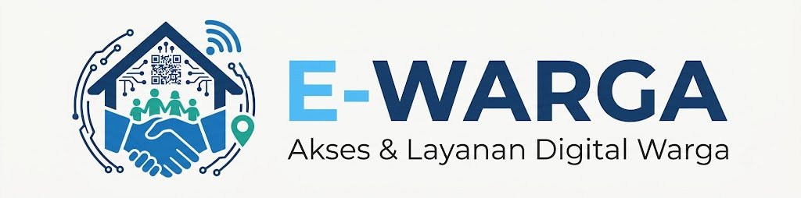
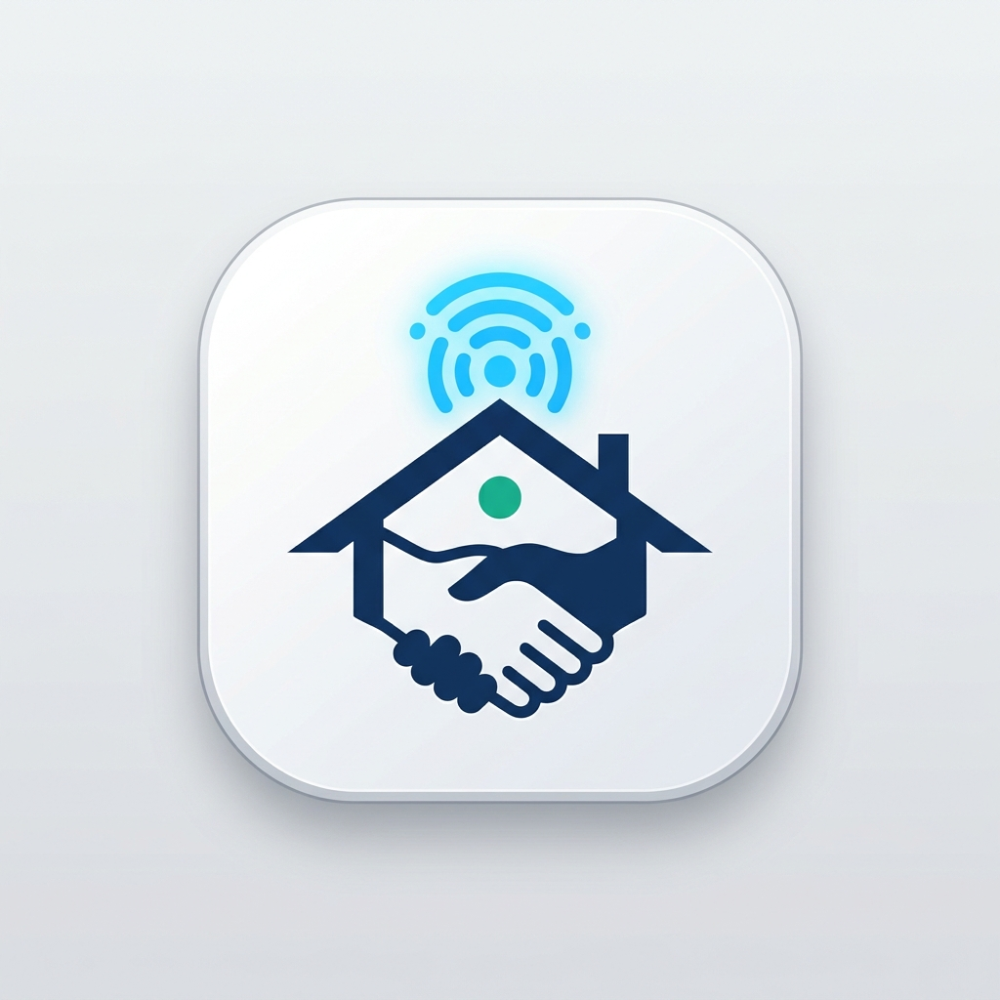

# 🖼️ E-WARGA - Brand Identity & Visual Assets (README PICTURE)
> **Katalog Identitas Visual, Logo Resmi, dan Ikon Aplikasi E-WARGA (Pure Professional & Clean PropTech)**

Dokumen ini memuat seluruh aset visual resmi untuk platform **E-WARGA**, lengkap dengan filosofi desain, aturan proporsi, dan panduan implementasi antarmuka.

---

## 🏛️ 1. Logo Utama Horizontal (Official Horizontal Logo)

Logo ini adalah identitas visual utama yang digunakan pada:
* Header Website Desktop / Panel Login Pengurus.
* Kop Surat Resmi RT/RW & Dokumen Berita Acara.
* Faktur / Bukti Kuitansi Pembayaran Iuran Kas RT.
* Spanduk & Neon Box di Gerbang Pos Satpam.



### 📋 Deskripsi & Bedah Makna Simbol:
1. **Atap Rumah (Navy Blue `#1B365D`):**
   * Merepresentasikan perlindungan tempat tinggal, kawasan perumahan/cluster, dan ketenangan keluarga.
2. **Jabat Tangan di Pondasi Rumah:**
   * Melambangkan asas gotong royong, transparansi, serta kesepakatan harmonis antara Pengurus RT dan Warga.
3. **QR Code & Garis Sirkuit PCB:**
   * Menunjukkan implementasi teknologi modern: sistem palang pintu otomatis (*Smart Gate*), tiket tamu digital, dan otomatisasi administrasi.
4. **Sinyal Wi-Fi & Ikon Pin Lokasi (Teal `#0D9488`):**
   * Melambangkan konektivitas internet lingkungan dan pemetaan klaster warga yang terdata secara presisi.
5. **Tipografi "E-WARGA":**
   * Kata **"E-"** (Sky Blue `#38BDF8`): Menegaskan kecepatan, digitalisasi, dan kemudahan akses.
   * Kata **"WARGA"** (Navy `#1B365D`): Menegaskan ketegasan, kekuatan komunitas, dan rasa aman.
6. **Tagline:** *"Akses & Layanan Digital Warga"*.

---

## 📱 2. Ikon Aplikasi Mobile (App Icon 1:1)

Ikon aplikasi yang dirancang khusus untuk layar smartphone (Android & iOS). Menggunakan prinsip *clean simplification* agar tidak buram di ukuran layar kecil (48x48 px hingga 128x128 px).



### 📋 Deskripsi & Keunggulan Desain:
* **Bentuk Dasar:** *Squircle* (persegi dengan sudut membulat halus standar iOS & Android Material Design).
* **Fokus Elemen:** Menyederhanakan detail rumit (menghilangkan bintik QR code dan garis mikro) dan hanya menonjolkan **Atap Rumah Navy + Jabat Tangan + Pancaran Sinyal Smart IoT Cyan**.
* **Kelebihan untuk Warga:** Sangat mencolok dan kontras di layar HP warga lansia/bapak-bapak, memudahkan mereka menemukan aplikasi E-WARGA dalam 1 detik.

---

## 🌐 3. Favicon Browser Tab (Desktop Web)

Favicon yang tampil di tab browser Google Chrome, Mozilla Firefox, Microsoft Edge, dan Safari. Dibuat dalam format vektor **SVG** yang tajam tanpa pecah di resolusi layar mana pun.


### 📋 Spesifikasi Teknis:
* **File Asset:** `docs/images/favicon.svg` (dan `favicon.ico` untuk kompatibilitas browser lama).
* **Ukuran Standar:** Skalabel otomatis dari `16x16 px`, `32x32 px`, hingga `64x64 px`.
* **Keterbacaan Tab:** Menggunakan latar belakang Navy dengan kontras Atap Rumah Putih dan pendaran sinyal Cyan agar langsung terlihat jelas saat browser membuka 20+ tab sekaligus.
* **Implementasi di Blade HTML:**
  ```html
  <link rel="icon" type="image/svg+xml" href="{{ asset('favicon.svg') }}">
  <link rel="alternate icon" type="image/png" href="{{ asset('favicon.png') }}">
  ```

---

## 🎨 4. Spesifikasi Warna Resmi (Brand Color Palette)

```css
/* Palette Utama E-WARGA (Tailwind CSS Ready) */
:root {
  --ewarga-navy:       #1B365D; /* Primer: Keamanan, Wibawa, Atap & Teks Utama */
  --ewarga-cyan:       #38BDF8; /* Aksen Tech: Sinyal IoT, Prefix "E-", Tombol Aktif */
  --ewarga-teal:       #0D9488; /* Komunitas: Siluet Keluarga, Pin Lokasi, Asri */
  --ewarga-green:      #10B981; /* Sukses: Status Lunas, Palang Pintu Terbuka */
  --ewarga-red:        #EF4444; /* Alert: Tombol Panik, Palang Pintu Terkunci */
  --ewarga-background: #F8FAFC; /* Latar Belakang: Bersih, Sejuk di Mata */
}
```

---

## 📐 5. Aturan Pemakaian Logo & Aset Visual

1. **Ruang Bebas (Clear Space):**
   * Selalu sisakan margin kosong minimal setinggi huruf "E" di sekeliling logo agar tidak bertumpuk dengan teks lain.
2. **Latar Belakang yang Diizinkan:**
   * Di atas latar putih/terang: Gunakan versi warna standar (seperti di atas).
   * Di atas latar gelap (misal di console pos satpam malam hari): Ubah teks "WARGA" dan garis atap menjadi putih bersih dengan aksen Cyan menyala.
3. **Larangan Desain:**
   * Jangan mengubah proporsi logo (menarik logo menjadi pipih atau lonjong).
   * Jangan mengganti warna biru dongker menjadi merah atau warna lain di luar panduan resmi.

